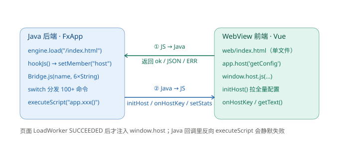
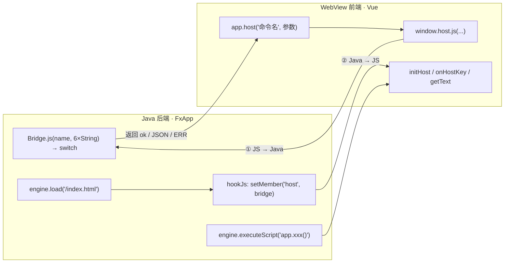
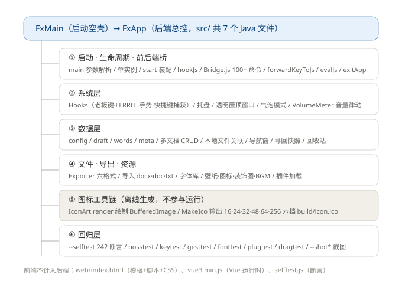
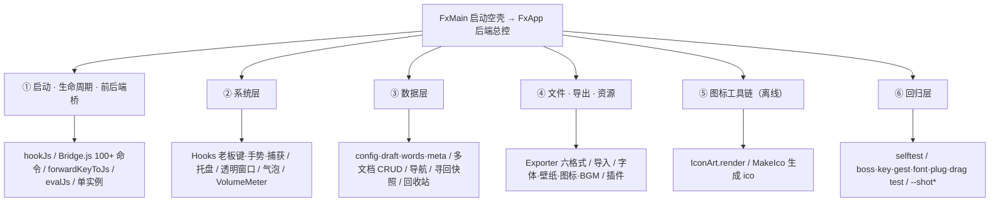
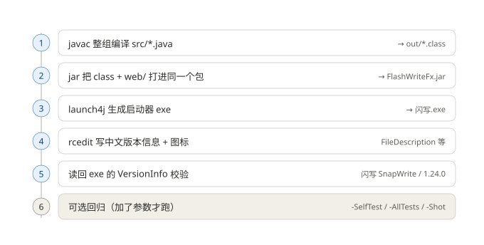
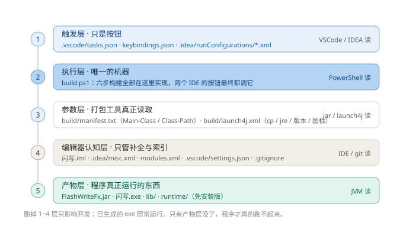
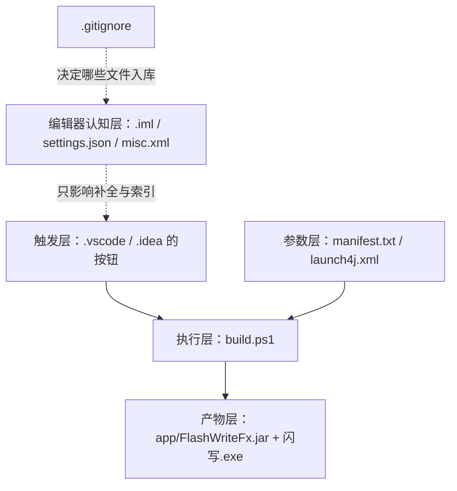

# 闪写 FlashWrite 开发手册

**前后端桥接 · 后端功能 · 打包流程 · 开发环境配置**

> 适用版本：功能批次 **v1.30**（手册正文按 2026-11-05 的 v1.24 快照整理，版本信息于 2026-11-09 复核）
> 项目根目录：`D:\WorkBuddyData\2026-10-30-14-40-10\flashwrite-hybrid\`，下文所有相对路径都以此为准。
> 配图（与本文件同目录，Markdown 预览可直接显示）：`bridge.svg`、`backend-tree.svg`、`build-pipeline.svg`、`config-layers.svg`。每张图下方另附可编辑的 Mermaid 源码，单独转发本 md 时图定义也不会丢。
> **行号说明**：文中行号基于 2026-11-05（`<style>` 移到文件底部之后）的代码快照，之后 v1.26–v1.30 又新增了外部网页、超链接、格式刷、中文斜体等功能，行号已明显漂移，请用文中关键字搜索定位；功能清单以仓库根目录 `README.md` 的「近期版本记录」为准。
> **git 基线**：`3e236a6`「打包逻辑变更」（2026-11-06）；2026-11-09 本轮功能与文档提交后，GitHub（此前因 502 落后一个提交）已补推，Gitee 网页端的 README 更新也已合并，**两个远程现已对齐**。具体 hash 以 `git log` 为准，状态详见 4.5 节。
> **命名**：项目正式名为「闪写 FlashWrite」。v1.30 已把 `build/launch4j.xml` 版本信息、exe 资源段（任务栏右键显示的 `闪写 FlashWrite`）、托盘提示、导出文件元数据、构建脚本、结构图、《使用说明》与发行压缩包名全部统一；仅保留三处**代码标识符**（不面向用户显示）：插件 API `window.snapwrite`、导入字体族名 `SnapWriteCustom`、以及开机自启注册表项名 `SnapWrite`（改名会让老机器残留重复自启项）。
> **exe 文件版本**：`build/launch4j.xml` 里的 `<fileVersion>` 仍是 `1.24.0.0`（右键属性显示值），与 `v1.xx` 功能批次号不是一回事。
> 阅读建议：日常改动直接看 **第 3.5 节对照表**；要加功能看 **第 1.8 节**；换电脑或重装 IDE 看 **第 3.6 节** 与 **第 4 章**。

---

## 目录

- [0. 先建立整体认知](#0-先建立整体认知)
- [1. 前后端怎么连接，具体代码在哪](#1-前后端怎么连接具体代码在哪)
- [2. 后端功能（树状结构）](#2-后端功能树状结构)
- [3. 打包执行了什么，以后自己怎么搞](#3-打包执行了什么以后自己怎么搞)
- [4. 配置文件怎么生效，删掉会怎样](#4-配置文件怎么生效删掉会怎样)
- [附录 A 命令速查](#附录-a-命令速查)
- [附录 B 关键行号索引](#附录-b-关键行号索引)
- [附录 C 本次整理对应的改动与回归结果](#附录-c-本次整理对应的改动与回归结果)

---

## 0. 先建立整体认知

三句话：

1. **这是一个单体桌面应用**，不是前后端分离服务：Java 负责窗口、系统钩子、文件与导出；界面全部由 JavaFX `WebView` 里的 HTML/CSS/Vue3 渲染。
2. **没有 HTTP、没有 WebSocket、没有 Node**：Java 与网页靠 JavaFX 的 *LiveConnect* 互相直接调方法（相当于 Electron 的思路，但换成纯 Java 生态）。
3. **一份代码、一个根目录**：`src/` 是后端，`web/` 是前端，两者被打进**同一个 jar**；VSCode 和 IDEA 都打开同一个根目录，只是各自的"按钮配置"不同。

目录结构（只列与开发有关的）：

```text
flashwrite-hybrid/
├─ src/                    7 个 Java 源文件（后端全部逻辑）
│  ├─ FxMain.java          启动空壳 / 命令行开关
│  ├─ FxApp.java           总控：窗口、桥、托盘、数据、寻回、导出（3000+ 行）
│  ├─ Hooks.java           全局键鼠钩子
│  ├─ Exporter.java        六格式导出引擎
│  ├─ VolumeMeter.java     系统音量峰值
│  ├─ IconArt.java         图标绘制
│  └─ MakeIco.java         生成 build/icon.ico（离线工具）
├─ web/
│  ├─ index.html           ★ 模板 + JS + CSS 全在这一个文件（Vue createApp 在内）
│  ├─ vue3.min.js          Vue3 官方生产压缩版（不要读、不要改）
│  └─ selftest.js          315 条前端断言（v1.30）
├─ build/
│  ├─ manifest.txt         jar 的 Main-Class / Class-Path
│  ├─ launch4j.xml         exe 生成参数、版本信息、JRE 路径
│  └─ icon.ico             exe / 窗口 / 托盘图标源
├─ build.ps1               ★ 唯一的构建入口
├─ .vscode/                VSCode 的任务 / 快捷键 / 设置
├─ .idea/ + 闪写.iml       IDEA 的模块 / JDK / 运行配置
├─ .gitignore              决定哪些东西能进 git
├─ app/                    ★ 运行文件（exe 与 runtime 都从这里检索）
│  ├─ FlashWriteFx.jar     程序包（class + 前端资源）
│  └─ lib/                 第三方 jar（JNativeHook、PDFBox、FontBox、commons-logging）
├─ jfx/                    JavaFX 21 的 jar（本机开发用）
├─ tools/                  JDK 21、launch4j、rcedit（不入库）
├─ out/                    javac 产物（不入库）
├─ runtime/                jlink 裁出的迷你 Java（免安装版用，不入库）
├─ data/                   用户文档 / 配置 / 寻回历史（严禁入库）
├─ dist/                   免安装发行目录（不入库）
└─ 闪写.exe                ★ 启动器（不内嵌 jar，运行时读 app/ 里最新的 jar）
```

术语速查：

| 词 | 含义 |
|---|---|
| WebView / WebEngine | JavaFX 内嵌的 WebKit 浏览器控件及其脚本引擎 |
| LiveConnect | Java ↔ JavaScript 互调机制（`JSObject.setMember` / `executeScript`） |
| `window.host` | Java 注入到网页里的桥对象；前端所有后端调用都走它 |
| `app`（Vue 变量） | Vue 实例（`Vue.createApp({...})` 的返回值，挂到 `window.app`），**不是目录** |
| `app/`（目录） | 放 `FlashWriteFx.jar` 与 `lib/` 的运行文件目录，exe 按 `app/...` 检索 |
| dontWrapJar | launch4j 的一种模式：exe 只是启动器，不把 jar 打包进 exe 内部 |
| jlink | JDK 自带工具，裁剪出只含所需模块的最小 Java 运行时 |

---

## 1. 前后端怎么连接，具体代码在哪



<details><summary>图源码（Mermaid，可编辑）</summary>



</details>

### 1.1 原理一句话

Java 在页面加载完成后，把一个 `Bridge` 对象塞进网页的 `window.host`；网页调 `window.host.js('命令名', 参数...)` 进 Java，Java 用 `engine.executeScript("app.方法()")` 反向调网页。**两边共享同一个进程、同一份内存**，所以数据是同步返回的字符串，不需要序列化协议。

`src/FxApp.java:36-51` 的架构注释原文就写了这层设计：

```java
/**
 * 闪写 FlashWrite 混合版 —— Java 后端 + WebView 前端（HTML/CSS/Vue）。
 *   Java 后端：全局键鼠钩子(Hooks)、系统托盘、窗口控制(置顶/透明/伸缩)、
 *              数据持久化(data/ 目录)、文本导出
 *   WebView  ：界面全部用 HTML/CSS/Vue 写（资源打包在 jar 根路径）
 *   桥梁     ：JS -> Java 通过 window.host（Bridge 对象）
 *              Java -> JS 通过 engine.executeScript("app.xxx()")
 */
```

### 1.2 启动链路（按时间顺序）

| 步 | 位置 | 做了什么 |
|---|---|---|
| 1 | `src/FxMain.java:56` | `main()` 解析 `--selftest` / `--shot*` 等开关，置静态标志 |
| 2 | `FxMain.java:85-89` | 单实例检查 `claimSingleInstance()`；已有实例就唤回它并退出；否则 `Application.launch(FxApp.class, args)` |
| 3 | `FxApp.java:229` | `loadAll()` 读 `data/` 下的草稿、词库、配置、元信息、寻回历史 |
| 4 | `FxApp.java:237` | **`Platform.setImplicitExit(false)`** —— 隐藏窗口不退出工具箱，老板键才能把窗口叫回来 |
| 5 | `FxApp.java:239-246` | 建 `WebView`、关掉自带右键菜单、取 `WebEngine`，`engine.load(getClass().getResource("/index.html").toExternalForm())` |
| 6 | `FxApp.java:248-250` | `LoadWorker` 到 `SUCCEEDED` 才调 `hookJs()` |
| 7 | `FxApp.java:861-874` | 注入桥 → `app.initHost()` → 加载插件 |
| 8 | `FxApp.java:252-289` | 场景、按键过滤、Stage 装配、托盘、全局钩子、音量监听、`stage.show()` |
| 9 | `FxApp.java:291-300` | 若带测试开关，分派到对应 `run*Test()` |

第 5 步的完整代码（`FxApp.java:239-250`）：

```java
WebView web = new WebView();
webView = web;
web.setContextMenuEnabled(false);   // 关掉 WebView 自带右键菜单（"刷新文档"那条）
engine = web.getEngine();
engine.load(getClass().getResource("/index.html").toExternalForm());
// 页面加载完成后挂载 JS 桥（必须在 load 完成后，否则 window 上挂不上）
engine.getLoadWorker().stateProperty().addListener((ov, oldV, newV) -> {
    if (newV == Worker.State.SUCCEEDED) hookJs();
});
```

> **注意**：`/index.html` 是 **jar 根路径**资源。打包命令 `jar ... -C out . -C web .` 把 `web/` 里的内容平铺到 jar 根，所以 `index.html`、`vue3.min.js`、`selftest.js` 都是从 jar 里读的。这意味着**改了 `web/index.html` 必须重打 jar 并重启应用**，磁盘上的文件不会被运行中的程序读到。

### 1.3 通道一：JS → Java

**① Java 注入桥对象**（`FxApp.java:860-875`）：

```java
/** 把 Java 端 Bridge 暴露为 window.host，并通知前端初始化 */
private void hookJs() {
    JSObject win = (JSObject) engine.executeScript("window");
    // 注意：必须持有强引用！JSObject.setMember 对普通 Java 对象只持弱引用，
    // 不保存字段的话 Bridge 会被 GC，之后 JS 调用全部静默失效（经典大坑）
    bridge = new Bridge();                       // 字段定义在 FxApp.java:153
    win.setMember("host", bridge);
    engine.executeScript("window.__hostReady = true;");
    Object errs = engine.executeScript("window.__errs ? window.__errs.join(' | ') : ''");
    if (errs != null && !errs.toString().isEmpty()) {
        System.out.println("[闪写] 页面 JS 错误: " + errs);
    }
    engine.executeScript("if (window.app && app.initHost) app.initHost();");
    loadPlugins();
}
```

**② 前端统一出口**（`web/index.html:1445-1449`，行号按 CSS 移动后的版本）：

```js
/* ---------- 桥 ---------- */
host: function(name, a, b, c, d, e, f) {
  if (!window.host || !window.host.js) return undefined;
  function s(v) { return (v === undefined || v === null) ? '' : String(v); }
  return window.host.js(name, s(a), s(b), s(c), s(d), s(e), s(f));
},
```

**③ 后端万能调度**（`FxApp.java:2012-2031`）：

```java
/* JS 桥：WebView 里的 Vue 通过 window.host 调用这些公开方法
   （JS -> Java 在 FX 线程执行，可直接操作 Stage） */
public class Bridge {
    /* 实测 JavaFX WebView 的 LiveConnect 派发对"无返回值方法"会静默失败
       （getter 正常、void 方法不执行也不报错）。
       因此 JS 端所有动作一律走 js('方法名','参数1',...)，返回 "ok"/数据/"ERR:..."。 */
    public String js(String name, String a1, String a2, String a3, String a4,
                     String a5, String a6) {
        try {
            switch (name == null ? "" : name) {
                case "getConfig":    return getConfig();
                case "getWords":     return getWords();
                case "getDraft":     return getDraft();
                case "getDraftHtml": return getDraftHtml();
                case "linkDocTo":    return linkDocTo(a1);
                case "unlinkDoc":    unlinkDoc(); break;
                ...
```

设计约束（都是踩过坑换来的）：

- **所有方法必须有返回值**：LiveConnect 对 `void` 方法静默失败，不报错也不执行。所以统一 `js(name, 6 个 String)`，成功返回 `"ok"` 或 JSON，失败返回 `"ERR:..."`（`default` 分支在 `:2206`）。
- **参数全是 String**：跨语言只传字符串，复杂结构用 JSON 字符串（前端 `JSON.parse`）。
- **`bridge` 字段必须强引用**：`setMember` 只持弱引用，不存字段会被 GC，之后所有调用无声失效。
- **JS→Java 的回调本身在 FX 线程**，可以直接操作 Stage；反过来从别的线程调 JS 必须用 `evalJs()` 或 `Platform.runLater`。

### 1.4 通道二：Java → JS

统一形式是 `engine.executeScript("脚本字符串")`。主要调用点：

| 位置 | 脚本 | 用途 |
|---|---|---|
| `FxApp.java:867` | `window.__hostReady = true;` | 告诉前端桥已就绪 |
| `FxApp.java:873` | `if (window.app && app.initHost) app.initHost();` | 触发前端拉取配置 |
| `FxApp.java:932-933` | `String(app.onHostKey('Ctrl+F'))` | 快捷键转发，返回值决定是否 `consume` |
| `FxApp.java:1190-1191` | `app.onShown()` / `app.enterBubble()` | 托盘唤回时同步界面状态 |
| `FxApp.java:1214-1215` | `notifyJs(script)` | 通用单向通知（吞异常） |
| `FxApp.java:1473` | `app.setStats(...)` | 推送字数统计 |
| `FxApp.java:1821` | `if(window.app&&app.getText)app.getText();else ''` | 退出前抓正文存盘 |
| `FxApp.java:1884-1888` | `app.testFill()` / `app.enterBubble()` | 截图与自测注入 |

跨线程同步取返回值用 `evalJs()`（`FxApp.java:845-858`）——它用 `CountDownLatch + Platform.runLater`，并且**必须在 FX 线程内就把结果转成字符串**（`JSObject.toString()` 会检查线程）：

```java
private String evalJs(final String js) {
    final Object[] box = new Object[1];
    final CountDownLatch latch = new CountDownLatch(1);
    Platform.runLater(() -> {
        try { box[0] = String.valueOf(engine.executeScript(js)); }
        catch (Throwable ex) { box[0] = "ERR " + ex; }
        latch.countDown();
    });
    try { latch.await(6, TimeUnit.SECONDS); } catch (Exception ignored) {}
    return box[0] == null ? "" : String.valueOf(box[0]);
}
```

### 1.5 初始化数据流

`web/index.html:1456` 的 `initHost()` 是**前后端的第一次握手**：Java 调它，它反过来把全部配置一次拉进 Vue：

```js
initHost: function() {
  this.cfg = JSON.parse(this.host('getConfig'));
  if (!this.cfg.keys) this.cfg.keys = {};
  this.gestureInput = this.cfg.gesture;
  this.words = JSON.parse(this.host('getWords'));
  this.autoStart = this.host('isAutoStart') === 'true';
  this.iconUrl = this.host('getIcon') || '';
  this.customIcon = this.host('getCustomIcon') || '';
  this.wallpaper = this.host('getWallpaper') || '';
  this.fontFamily = this.cfg.fontName || '';
  this._fontData = this.host('getFontData') || '';
  ...
}
```

之后用户点任何按钮，都是 `this.host('命令名', 参数)` → `Bridge.js` 的某个 `case` → 返回字符串 → 前端自己更新状态或落字。

### 1.6 三条旁路

- **快捷键转发**（`FxApp.java:904-940` `forwardKeyToJs`）：注册在 `scene.addEventFilter`（`:257`）。DOM 的 `KeyboardEvent` 在中文输入法下 `key` 可能是 `Process`、`code` 可能为空，而且 **WebView 会把 Tab 拿去遍历焦点**，DOM 根本收不到。所以 JavaFX 这一层组出标准组合串（`Ctrl+F` / `Tab` / `Esc`…）交给 `app.onHostKey(...)`，返回 `"true"` 就 `e.consume()` 防止双触发。快捷键录制期间 `rec` 为真会放行一切键。
- **主题变量注入**（`web/index.html:4840-4852`）：`var st = document.documentElement.style; st.setProperty('--accent', a);` —— 写在 **inline style** 上，优先级高于任何 `<style>` 规则，所以 CSS 块放在 head 还是 body 末尾都不影响主题色。
- **动态字体**（`:4887-4894`、`:4902-4913`）：往 `document.head` 追加一个 `id="dynfont"` 的 `<style>`，内容只有 `@font-face` 定义，不覆盖业务规则，同样与 CSS 块位置无关。

### 1.7 铁律与排错清单

| 现象 | 真凶 / 处理 |
|---|---|
| 前端调后端"点了没反应、不报错" | 桥方法写成了 `void`；或 `bridge` 没强引用被 GC；或命令名拼错落到 `ERR:no-such-method` |
| **Java 回调里反向 `executeScript` 静默失败** | 桥接重入。铁律：**数据一律当 `js()` 的返回值交给前端落字**，绝不在 Java 回调里回头调 JS。导出、寻回都栽过 |
| 改了 `index.html` 不生效 | 页面从 jar 读；要 `build.ps1 -JarOnly` + 重启应用 |
| 快捷键时灵时不灵 / Tab 无效 | 走 `forwardKeyToJs`，不要只靠 DOM `keydown` |
| 窗口隐藏后叫不回来 | `Platform.setImplicitExit(false)` 被删了 |
| 右键冒出"刷新文档" | `web.setContextMenuEnabled(false)` 被删了 |
| JS 报错看不到 | 前端 `window.__errs` 捕获，`hookJs()` 会打印；Vue 的渲染错走 console 不进 `window.onerror`，靠 `app.config.errorHandler` 收进 `__errs` |

### 1.8 怎么新增一个后端能力（标准 5 步）

1. 在 `src/FxApp.java` 写业务方法（如需持久化，记得 `saveConfig()` / `saveDraft()`）。
2. 在 `Bridge.js()` 的 `switch`（`:2025` 起）加 `case "xxx": return xxx(a1, a2);`。
3. 前端 `web/index.html` 里用 `this.host('xxx', 参数...)` 调，返回值自己处理；**不要指望 Java 反过来塞数据**。
4. 若新功能要出现在设置面板，同步改 `getConfig()` / `saveConfig()` 的配置键。
5. 在 `web/selftest.js` 加断言 → `build.ps1` 完整构建 → `build.ps1 -SelfTest` 验收。

---

## 2. 后端功能（树状结构）



<details><summary>图源码（Mermaid，可编辑）</summary>



</details>

### 2.1 七个 Java 文件

| 文件 | 职责 | 关键位置 |
|---|---|---|
| `FxMain.java` | 独立 `main` 空壳（不继承 `Application`，规避 JavaFX 启动器把参数误当 FX 参数的坑）；解析命令行开关、单实例检查、拉起 `FxApp` | 类注释 3-10；`main` 56-90 |
| `FxApp.java` | 后端总控：Stage/WebView 生命周期、`window.host` 桥、托盘与老板键、钩子对接、配置/文档持久化、寻回、导入导出、插件、全部回归 | 架构注释 36-51；`start` 220-301；`Bridge` 2016 |
| `Hooks.java` | JNativeHook 全局键鼠钩子：老板键四键组合、`LLRRLL` 鼠标手势、快捷键捕获（任何软件前台都生效） | 类注释 16-27；`register` 122-177；`fireBoss` 304 |
| `Exporter.java` | 纯 Java 多格式排版导出 TXT/MD/HTML/RTF/DOCX/PDF，不碰 JavaFX，可独立 `--exporttest` | 注释 24-33；`parse` 65；`export` 648 |
| `VolumeMeter.java` | 系统音量峰值监听（借 Windows `csc.exe` 现编译 C# COM 程序读 `IAudioMeterInformation`），驱动音乐律动，失败静默降级 | 注释 8-18；`peak` 27；`start` 30 |
| `IconArt.java` | 统一渲染应用图标 `BufferedImage`，窗口/托盘/exe 四处共用 | 注释 6-12；`render` 15 |
| `MakeIco.java` | 独立工具 `main`：调 `IconArt` 渲染 16/24/32/48/64/256 六档，写小端 Windows ICO | `main` 14-41 |

### 2.2 文本版功能树（便于搜索）

```text
FxMain（启动壳）
└─ FxApp（后端总控）
   ├─ ① 启动与桥接   start / loadAll / setImplicitExit(false) / hookJs / Bridge.js / forwardKeyToJs / evalJs / exitApp
   ├─ ② 系统层
   │  ├─ Hooks        老板键 Ctrl+Shift+Z+X · LLRRLL 手势 · 快捷键捕获 · 隐藏时 scheduleSummon 唤回
   │  ├─ 托盘          initTray / 自绘菜单 / hideToTray / showFromTray / 单实例唤回
   │  ├─ 窗口          透明 Stage / 置顶 / 最小化 / 拉伸 / 透明度
   │  ├─ 气泡模式      enterBubble / exitBubble / resizeBubble / 光标行自适应 / 边缘三拍拉伸
   │  └─ 音量          VolumeMeter.peak() → 云朵律动
   ├─ ③ 数据层
   │  ├─ 配置与草稿     config.properties / draft.txt / words.txt / meta.properties
   │  ├─ 多文档         newDoc / switchDoc / renameDoc / deleteDoc / importDocFile / 本地文件关联
   │  ├─ 导航悬浮窗     popNav / updateNav / buildNavWindow / 标签与底纹跳转
   │  └─ 寻回快照       40s 节流 + 小改动合并 + 分层抽稀（10min→1h→24h→7d→30d）/ 按文档独立 / 回收站
   ├─ ④ 文件与资源
   │  ├─ 导出           Exporter：TXT / MD / HTML / RTF / DOCX / PDF（中文子集内嵌字体）
   │  ├─ 导入           docx / doc(二进制) / txt 智能分段
   │  ├─ 字体库         导入字体保留扩展名 + cssFamily() 换算族名 + @font-face 注册
   │  ├─ 素材           壁纸 / 自定义图标（含提取其它 exe 的 shell 图标）/ 装饰图 / BGM
   │  └─ 插件           data/plugins/*.js，暴露 window.snapwrite API
   ├─ ⑤ 图标工具链（离线） IconArt.render → MakeIco → build/icon.ico
   └─ ⑥ 回归层         --selftest / --bosstest / --keytest / --gesttest / --fonttest / --plugtest / --dragtest / --shot*
```

### 2.3 `Bridge.js()` 命令分组（`FxApp.java:2025-2205`）

| 组 | 代表命令（行号见源码 switch） |
|---|---|
| A 配置读取 | `getConfig` 2027 · `getWords` 2028 · `getDraft` 2029 · `getDraftHtml` 2030 · `getIcon` 2036 · `getWallpaper` 2037 · `getFontData` 2038 · `listSystemFonts` 2041 · `listPlugins` 2197 |
| B 配置写入 | `setAppearance` 2089 · `setTheme` 2113 · `setSkin` 2114 · `setHeadingCfg` 2096 · `setStyleFonts` 2097 · `setBubbleConfig` 2079 · `setBubbleLines` 2147 · `setAutoStart` 2090 · `setCloseAction` 2122 |
| C 文档草稿 | `saveDraft` 2052 · `saveNow` 2064 · `newDoc` 2059 · `switchDoc` 2060 · `renameDoc` 2061 · `deleteDoc` 2062 · `importDocFile` 2063 · `linkDocTo` 2032 · `clearAll` 2078 |
| D 词库 | `addWord` 2068 · `deleteWord` 2069 · `updateWord` 2070 |
| E 字体 | `pickFont` 2093 · `clearFont` 2094 · `deleteFont` 2045 · `getFontDataByFile` 2044 |
| F 资源选取 | `pickWallpaper` 2091 · `pickDecorImage` 2098 · `pickMusic` 2086 · `pickCustomIcon` 2139 · `pickExeIcon` 2140 · `resetCustomIcon` 2141 |
| G 导出 | `exportAs` 2077 · `exportDocAs` 3299 → `exportCommon` 3316 → `Exporter.export` 3348 |
| H 窗口与气泡 | `moveBy` 2104 · `setSize` 2105 · `togglePin` 2109 · `hideWindow` 2111 · `enterBubble` 2080 · `exitBubble` 2081 · `resizeBubble` 2082 · 边缘拉伸三拍 2156/2163/2177 |
| I 键鼠配置 | `beginCapture` 2072 · `setBoss` 2073 · `setBossEnabled` 2074 · `setGesture` 2075 · `setKey` 2120 · `resetKeys` 2121 · `cancelCapture` 2195 |
| J 寻回与回收站 | `listHistory` 2124 · `restoreHistory` 2125 · `listHistDocs` 2132 · `getHistoryText` 2128 · `listDeleted` 2130 · `restoreDeleted` 2131 · `purgeAllHistory` 2134 |
| K 插件 | `listPlugins` 2197 · `importPlugin` 2198 · `openPluginsDir` 2199 |
| L 系统杂项 | `getSysPeak` 2194 · `isAutoStart` 2051 · `setWinOpacityPercent` 2102 · `setMusicFollow` 2190 · `openFontsDir` 2043 |

兜底：`default` → `ERR:no-such-method:<name>`（2206）；异常 → `ERR:<msg>`（2209-2210）；成功统一返回 `"ok"`（2208）。

### 2.4 系统模块定位速查

| 模块 | 入口 / 行号 |
|---|---|
| 窗口与气泡尺寸 | `enterBubble` 3118 · `exitBubble` 3146 · `resizeBubble` 3229 · `startBubbleWatch` 3211 |
| 系统托盘 | `initTray` 1063 · `showTrayPopup` 1085 · `hideToTray` 1156 · `showFromTray` 1165 |
| 老板键 | `toggleBoss` 1142 · `setBoss` 2656 · `Hooks.matchBoss` 204 · `Hooks.fireBoss` 304 |
| 全局钩子对接 | `FxApp.start` 268-283 · `syncHooksConfig` 981 · `Hooks.register` 122 · `Hooks.scheduleSummon` 320 |
| 文档落盘 | `loadAll` 1303 · `saveDraft` 1444 · `exitApp` 1817 · `saveSnapshotOnExit` 1776 |
| 寻回快照 | `appendHistory` 1513 · `pruneHistory` 1561 · `loadHistory` 1627 · `restoreHistory` 3493 |
| 导入导出 | `exportCommon` 3316 · `importDoc` 3596 · `parseDocx` 3624 · `Exporter.export` 648 |
| 回归入口 | `runSelfTest` 813 · `runBossTest` 630 · `runKeyTest` 667 · `runGestTest` 308 · `runShotTest` 1878 |

### 2.5 `data/` 目录里有什么

```text
data/
├─ draft.txt            当前正文纯文本
├─ words.txt            自定义词库
├─ config.properties    全部设置（主题、字体、气泡、快捷键、老板键…）
├─ meta.properties      今日/总字数
├─ docs/                多文档，每篇一个文件（另有伴生 .html 保存格式）
├─ hist/                寻回历史，按文档独立：<文档名>.hist / *.deleted.hist
├─ fonts/               导入的字体文件（必须保留原扩展名）
├─ plugins/             用户插件 .js
└─ selftest/            自测与截图用的隔离数据根（绝不碰真实草稿）
```

### 2.6 回归入口与用途

| 开关 | 验什么 | 通过标志 |
|---|---|---|
| `--selftest` | 前端 242 条断言（格式、气泡、词库、导航、快捷键、桥接） | `PASS=242 FAIL=0` |
| `--bosstest` | 老板键隐藏 → 唤回 → 退出 | `BOSSTEST SHOW_OK` |
| `--keytest` | Robot 真敲键盘，抓合成事件验不出的真机故障 | `errs=` 为空 |
| `--gesttest` | Robot 真点 `LLRRLL`，含 260ms/拍慢手势 | `MOUSE_OK` |
| `--fonttest` / `--plugtest` / `--dragtest` | 字体导入 / 插件 API / 气泡拖动 | 各自独立数据根 |
| `--shot*` | 生成 `ui_*.png` 截图，肉眼核对排版 | `SNAPSHOT_OK` |

---

## 3. 打包执行了什么，以后自己怎么搞



<details><summary>图源码（Mermaid，可编辑）</summary>


</details>

### 3.1 一句话

在项目根目录执行：

```powershell
powershell -NoProfile -ExecutionPolicy Bypass -File build.ps1
```

VSCode 的 `Ctrl+Alt+B`、IDEA 的「闪写 完整构建」最终都是这一条命令。**脚本自己用 `$PSScriptRoot` 定位根目录，从哪调用都行，仓库整体搬家也不会坏。**

### 3.2 六步逐条拆解

| 步 | `build.ps1` 行号 | 实际执行的命令 | 产物 |
|---|---|---|---|
| 1 编译 | 98-115 | `javac --release 21 --module-path jfx --add-modules javafx.web,javafx.controls,javafx.swing -cp "app/lib/*" -d out src/*.java` | `out/*.class` |
| 2 打 jar | 117-129 | 先确保 `app/` + `app/lib/` 存在，再 `jar --create --file app/FlashWriteFx.jar --manifest build/manifest.txt -C out . -C web .` | `app/FlashWriteFx.jar` |
| 3 生成 exe | 130-146 | `tools/launch4j/launch4jc.exe build/_launch4j.local.xml` | `闪写.exe` |
| 4 版本信息 | 147-157 | `rcedit 闪写.exe --set-version-string FileDescription "闪写 FlashWrite" ... --set-icon build/icon.ico` | exe 资源段 |
| 5 校验 | 162-164 | 读 `(Get-Item 闪写.exe).VersionInfo` 打印描述与版本 | 控制台 `exe: 闪写 FlashWrite / 1.24.0` |
| 6 回归（可选） | 167-176 | 按参数跑 `FxMain --selftest / --bosstest / --keytest / --gesttest / --shot-bubble` | 断言输出 / `ui_hybrid.png` |

细节与坑：

- **第 1 步必须整组编译**：`FxApp` 引用 `FxMain` 的静态字段，单文件 `javac` 必炸。`-JarOnly` 时用 `Test-NeedCompile()`（`:48-61`）逐个 `.java` 比对自己的 `.class`，没有 Java 改动就跳过编译。
- **第 2 步的 `-C web .` 是关键**：让 `index.html` 落在 jar 根，`getResource("/index.html")` 才找得到。
- **第 3 步的临时配置**：`launch4j.xml` 里 `<outfile>` / `<icon>` 写的是绝对路径，脚本只读原文并**只替换这两行文本**生成 `build/_launch4j.local.xml`，用完删掉。绝对不能用 `XmlDocument.Save()` 重新序列化整个 XML——它会把空的 `<maxVersion></maxVersion>` 改成自闭合，launch4j 直接报 `Invalid data: Maximum JRE version...`。
- **第 4 步为什么用 rcedit**：windres 会把 UTF-8 中文写成乱码，rcedit 才正确。`FileDescription` / `ProductName` 写的是 `errTitle + " " + productName`，即 `闪写 FlashWrite`——任务栏右键显示的名称就来自这里，**绝不能留空**。
- **脚本源码必须纯 ASCII**：本机 Windows PowerShell 5.1 把无 BOM 的 UTF-8 脚本按 GB2312 读，中文字面量会乱码。所有中文（exe 名、版本描述）都从 UTF-8 的 `launch4j.xml` 读，脚本里一个中文都没有。

### 3.3 两个"参数文件"全文

**`build/manifest.txt`**（JVM 读，`java -jar` 靠它找主类和依赖）：

```text
Main-Class: FxMain
Class-Path: lib/jnativehook-2.2.2.jar lib/pdfbox-2.0.31.jar lib/fontbox-2.0.31.jar lib/commons-logging-1.2.jar ../jfx/javafx-base-21.0.5-win.jar ../jfx/javafx-graphics-21.0.5-win.jar ../jfx/javafx-controls-21.0.5-win.jar ../jfx/javafx-media-21.0.5-win.jar ../jfx/javafx-swing-21.0.5-win.jar ../jfx/javafx-web-21.0.5-win.jar
```

**`build/launch4j.xml`**（launch4j 读；节选关键字段）：

```xml
<dontWrapJar>true</dontWrapJar>        <!-- exe 只是启动器，jar 不内嵌 -->
<headerType>gui</headerType>           <!-- 不弹控制台黑框 -->
<jar>app/FlashWriteFx.jar</jar>
<outfile>.../闪写.exe</outfile>        <!-- 由 build.ps1 临时替换成当前路径 -->
<errTitle>闪写</errTitle>
<icon>.../build/icon.ico</icon>        <!-- 同上 -->
<classPath>
  <mainClass>FxMain</mainClass>
  <cp>app/FlashWriteFx.jar</cp>
  <cp>app/lib/jnativehook-2.2.2.jar</cp>
  <cp>app/lib/pdfbox-2.0.31.jar</cp>
  <cp>app/lib/fontbox-2.0.31.jar</cp>
  <cp>app/lib/commons-logging-1.2.jar</cp>
</classPath>
<jre>
  <path>runtime</path>                <!-- 免安装版：优先用 exe 旁边的 runtime\ -->
  <requires64Bit>true</requires64Bit>
  <minVersion>21</minVersion>
  <maxVersion></maxVersion>           <!-- 空元素，别改成自闭合 -->
  <opt>--add-opens javafx.web/com.sun.javafx.webkit=ALL-UNNAMED</opt>
</jre>
<versionInfo>
  <fileVersion>1.24.0.0</fileVersion>
  <txtFileVersion>1.24.0</txtFileVersion>
  <productName>FlashWrite</productName>
  ...
</versionInfo>
```

> **新增第三方 jar 时要改两处**：`build/manifest.txt` 的 `Class-Path` **和** `launch4j.xml` 的 `<cp>`，漏一个就会出现"命令行能跑、双击 exe 报 NoClassDefFoundError"。

> **注意：两套相对路径的基准不同，最容易写错。** jar 现在放在 `app/` 里：
> - `launch4j.xml` 的 `<cp>` 由 **exe** 解析，基准是 exe 所在目录（`<chdir>.</chdir>`）→ 必须写 `app/FlashWriteFx.jar`、`app/lib/xxx.jar`；
> - `build/manifest.txt` 的 `Class-Path` 由 **jar** 解析，基准是 jar 自己所在的 `app/` → 第三方 jar 仍写 `lib/xxx.jar`，本机 JavaFX 要写 `../jfx/xxx.jar`（往上一级回到项目根）。
>
> 两处写成一样的路径，必定有一边找不到文件。**也别把业务 jar 塞进 `runtime/`**：jlink 重建会清空整个目录，而且 JVM 不会自动扫描 `runtime/lib` 里的 jar，照样得写 classpath。

### 3.4 参数速查

| 参数 | 行为 | 什么时候用 |
|---|---|---|
| `-JarOnly` | 按需编译 + 只重打 jar（跳过 exe 与 rcedit） | 只改了 `web/` 里的文件 |
| 无参数 | 完整六步 | 改了 `src/*.java`、改版本/图标、要交付 |
| `-SelfTest` | 完整构建 + `--selftest` | 常规验收 |
| `-AllTests` | 完整构建 + selftest / bosstest / keytest / gesttest | 大改之后（`gesttest` 会用 Robot 真点鼠标，运行时别动鼠标） |
| `-Shot` | 完整构建 + `--shot-bubble` 截图 | 肉眼核对排版 |

> `dontWrapJar=true` 意味着 **exe 是固定启动器，运行时读 `app/` 里最新的 jar**。所以只改前端时重打 jar 就够了，不用重打 exe；但按项目约定，正式交付前仍会完整重打一次 exe。注意：如果改了 `launch4j.xml` 的 `<cp>` 路径，就必须重打 exe，因为路径是编译进 exe 的。

### 3.5 保姆级场景对照表（最常用）

| 你要做的事 | 具体怎么点 / 怎么敲 | 之后 |
|---|---|---|
| 改 `web/index.html`（Vue、样式） | `build.ps1 -JarOnly`；VSCode `Ctrl+Alt+J`；IDEA 运行「闪写 快速打 jar」 | **重启应用**（页面从 jar 读，无热更新） |
| 改 `src/*.java` | `build.ps1`；VSCode `Ctrl+Alt+B`；IDEA「闪写 完整构建」 | 双击 `闪写.exe` |
| 改完想验证 | `build.ps1 -SelfTest` / `-AllTests` / `-Shot` | 看 `PASS=242 FAIL=0`、`SHOW_OK`、`ui_hybrid.png` |
| 改版本号 / exe 中文名 | 编辑 `build/launch4j.xml` 的 `fileVersion` / `txtFileVersion` / `productVersion` / `txtProductVersion` / `errTitle` / `productName` | 完整构建，看第 5 步打印 |
| 新增第三方 jar | jar 放进 `app/lib/` → `manifest.txt` 写 `lib/xxx.jar`（相对 jar）+ `launch4j.xml` 写 `app/lib/xxx.jar`（相对 exe） | 完整构建 |
| 换图标 | 替换 `build/icon.ico`（可用 `src/MakeIco.java` 重新生成六档） | 完整构建 |
| 加一个后端能力 | 见 [1.8 节](#18-怎么新增一个后端能力标准-5-步) | 完整构建 + 自测 |
| 发给没装 Java 的人 | 准备 `dist/`：`闪写.exe` + `app/`（内含 jar 与 lib）+ `runtime/` | 直接双击，见 3.7 |

### 3.6 换一台新电脑，从零开始（编号照做）

1. **拿代码**：`git clone` 仓库（或拷贝整个 `flashwrite-hybrid/` 目录）。
2. **补齐不入库的大件**（`.gitignore` 故意排除了它们）：
   - `tools/jdk-21.0.12.1+1/`（JDK 21，`build.ps1` 里写死了这个目录名）
   - `tools/launch4j/launch4jc.exe`、`tools/bin/rcedit.exe`
   - `jfx/`（JavaFX 21 的 6 个 win jar）

   `app/lib/` 的 4 个第三方 jar、`build/manifest.txt`、`build/launch4j.xml`、`build/icon.ico` 已随仓库入库，不用补。

3. **验证工具齐全**：脚本第 82-88 行会检查 `javac.exe / jar.exe / java.exe` 存在，缺了直接抛 `missing JDK tool`。
4. **第一次构建**：项目根目录 PowerShell 执行 `powershell -NoProfile -ExecutionPolicy Bypass -File build.ps1`。看到 `BUILD OK v1.24.0 -> 闪写.exe + app/FlashWriteFx.jar` 即成功。
5. **验收**：`build.ps1 -SelfTest`（应 `PASS=242 FAIL=0`），再 `build.ps1 -Shot` 看截图。
6. **打开 IDE**：VSCode 或 IDEA 都 `File → Open` 选**项目根目录**（不要只开 `src/` 或 `web/`）。IDEA 第一次会让你指定 JDK，选项目自带的 `tools/jdk-21.0.12.1+1`。
7. **日常循环**：改代码 → 按 3.5 表选命令 → 重启应用看效果 → 提交前跑一次 `-SelfTest`。

### 3.7 免安装发行包（零开发环境）

`launch4j.xml` 的 `<jre><path>runtime</path></jre>` 会让 exe 优先用旁边的 `runtime\`，但那个目录默认不存在，需要用 jlink 生成：

```powershell
jlink --module-path "tools/jdk-21.0.12.1+1/jmods;jfx" `
      --add-modules javafx.controls,javafx.media,javafx.swing,javafx.web,java.logging,jdk.crypto.ec,jdk.unsupported `
      --output build/runtime --no-header-files --no-man-pages --compress=zip-6 --strip-debug
```

> **`java.logging` 绝对不能省**：JNativeHook 的 `GlobalScreen` 静态初始化就要 `java.util.logging.Logger`。少了这个模块，程序照常启动、`--selftest` 也全过，但 `Hooks.register()` 的 `NoClassDefFoundError` 被 `catch (Throwable)` 静默吞掉 —— 免安装包里老板键 / 鼠标手势 / 全局快捷键**全部失效**（`--gesttest` 报 `MOUSE_DEAD`），退出时还会在 FX 线程抛异常。开发机是完整 JDK，所以只有拿**包内** `runtime/bin/java` 跑 `--gesttest` 看到 `MOUSE_OK` 才能验出这个坑。2026-11-09 已把发行目录那份缺模块的旧镜像换成含 `java.logging` 的镜像。

约 88MB。然后 `dist/` 放三样，业务文件统一收进 `app/`：

```text
dist/
├─ 闪写.exe
├─ 使用说明.txt
├─ app/
│  ├─ FlashWriteFx.jar
│  └─ lib/          （4 个第三方 jar + JNativeHook 的 DLL）
└─ runtime/         （jlink 产物，从 build/runtime 拷来）
```

发行包就是把这个目录（**不含 `data/`**，首次运行自动生成）压成 zip，放到项目外层目录，例如 `闪写 FlashWrite v1.30 免安装版.zip`。zip 本身不入库。

**刻意不带 `jfx/`**：dist 里没有 `jfx/`，manifest 中 `../jfx/...` 这些找不到的条目会被静默忽略，JavaFX 模块已从 runtime 镜像里解析；启动参数不用改。验证方式是用**包内** `runtime/bin/java` 按 `-cp "app/FlashWriteFx.jar;app/lib/*"` 直接跑 `--selftest` / `--bosstest` / `--gesttest` / `--traytest`，等价于最终用户环境；其中 `--gesttest` 是 JNativeHook 是否真的注册成功的唯一探针。

### 3.8 交付前验收清单

- [ ] `build.ps1` 完整构建打印 `BUILD OK`，且 `exe: 闪写 FlashWrite / 1.24.0`（中文不乱码）
- [ ] `--selftest`：`PASS=315 FAIL=0`（v1.30 基线）
- [ ] `--bosstest`：`BOSSTEST SHOW_OK`（偶发 `SHOW_FAIL` 是 FX 线程慢导致的判定竞态，日志里 2 秒后会补记 `visible=true`，单独重跑即可确认，不是功能坏了）
- [ ] `--keytest`：`errs=` 为空
- [ ] `--gesttest`：`MOUSE_OK`（含慢手势，偶发 `MOUSE_SLOW_GEST_WRONG` 可单独重跑确认）
- [ ] `--traytest`：`TRAYTEST TRAY_OK`（右键托盘不唤回、左键能打开、普通右键仍能唤回）
- [ ] `--shot-bubble`：`SNAPSHOT_OK`，截图里气泡配色/圆角/排版正常
- [ ] 用**包内** `runtime/bin/java` 再跑一次 `--selftest` / `--bosstest` / `--gesttest` / `--traytest`，确认零开发环境一致（`--gesttest` 必须 `MOUSE_OK`，缺 `java.logging` 会 `MOUSE_DEAD`）
- [ ] 截图与自测都跑在 `data/selftest` 隔离目录，没碰真实草稿与寻回历史
- [ ] 重打发行 zip：最新 `闪写.exe` + `app/` + `runtime/` + 使用说明，不含 `data/`

### 3.9 排错表

| 报错 / 现象 | 原因与处理 |
|---|---|
| `Invalid data: Maximum JRE version...` | 有人用 XML 序列化重写了 `launch4j.xml`，把 `<maxVersion></maxVersion>` 变成自闭合；恢复成显式空元素 |
| `missing JDK tool: ...` | `tools/jdk-21.0.12.1+1/bin/` 缺文件，或目录名被改 |
| `NoClassDefFoundError`（双击 exe 时） | 新 jar 只加了一处 Class-Path；`manifest.txt` 与 `launch4j.xml` 两处都要加 |
| exe 双击没反应 / 版本信息空白 | 第 4 步 rcedit 没跑；或 `<fileDescription>` 留空 |
| 改了前端页面没变化 | 没重打 jar，或没重启应用 |
| 中文脚本乱码 | `build.ps1` 被写进了中文字面量；保持纯 ASCII，中文从 XML 读 |
| 单文件 `javac` 编译失败 | 必须 `src/*.java` 整组编译 |
| `build.ps1 -AllTests` 中途报 `reg.exe` 被拦 | 本机沙箱把 `reg.exe` 列入黑名单，且 PowerShell 5.1 把 native stderr 当终止错误。断言本身不受影响，可直接在 Bash 里跑 `java ... FxMain --selftest` 取结果 |
| 自测偶发假 FAIL | 用独立数据根、先清 `_selRange` / `_range`；第 9 节有异步时序，必要时重跑 |

---

## 4. 配置文件怎么生效，删掉会怎样



<details><summary>图源码（Mermaid，可编辑）</summary>



</details>

**核心结论：这些文件全部只服务"写代码 / 打包"，一个都不参与程序运行。** 全部删掉，已经生成的 `闪写.exe` 照样能跑；坏的是开发环境。

### 4.1 分层模型

| 层 | 文件 | 谁读 | 作用 |
|---|---|---|---|
| 触发层 | `.vscode/tasks.json`、`keybindings.json`、`.idea/runConfigurations/*.xml` | VSCode / IDEA | 只是"按钮"，内容是一条命令字符串 |
| 执行层 | `build.ps1` | PowerShell | 六步构建的唯一实现 |
| 参数层 | `build/manifest.txt`、`build/launch4j.xml` | jar / launch4j / build.ps1 | 决定 jar 主类、依赖、exe 版本与 JRE 路径 |
| 编辑器认知层 | `闪写.iml`、`.idea/misc.xml`、`modules.xml`、`.vscode/settings.json` | IDE | 源码根、库、JDK、输出目录、侧栏过滤 |
| 产物层 | `app/FlashWriteFx.jar`、`闪写.exe`、`app/lib/`、`runtime/` | JVM | 程序真正运行的东西 |

### 4.2 逐文件代码与解释

#### 4.2.1 `.vscode/tasks.json`（5 个任务）

```jsonc
{
  "label": "闪写：仅重打 jar（改 HTML/JS 用）",
  "type": "shell",
  "command": "powershell",
  "args": ["-NoProfile", "-ExecutionPolicy", "Bypass",
           "-File", "${workspaceFolder}/build.ps1", "-JarOnly"],
  "group": { "kind": "build", "isDefault": true },   // 默认生成任务 = Ctrl+Shift+B
  "problemMatcher": [],
  "presentation": { "reveal": "always", "panel": "dedicated", "clear": true }
}
```

其余 4 个任务结构相同，只是 `args` 最后一段分别换成 无参数 / `-SelfTest` / `-AllTests` / `-Shot`，`label` 分别是「闪写：完整构建（改 Java 后必跑）」「闪写：自测」「闪写：全部回归」「闪写：气泡截图」。`${workspaceFolder}` 就是**项目根目录**——这也是为什么 VSCode 必须打开根目录。

#### 4.2.2 `.vscode/keybindings.json`（快捷键 = 按 label 找任务）

```jsonc
[
  { "key": "ctrl+alt+j", "command": "workbench.action.tasks.runTask",
    "args": "闪写：仅重打 jar（改 HTML/JS 用）" },
  { "key": "ctrl+alt+b", "command": "workbench.action.tasks.runTask",
    "args": "闪写：完整构建（改 Java 后必跑）" },
  { "key": "ctrl+alt+t", "command": "workbench.action.tasks.runTask", "args": "闪写：自测" }
]
```

`args` 必须与 `tasks.json` 的 `label` **逐字一致**；改了任务名忘了改这里，快捷键就会报"找不到任务"。

#### 4.2.3 `.vscode/settings.json`（只影响编辑器观感）

```jsonc
{
  "java.project.sourcePaths": ["src"],
  "java.project.outputPath": "target/vscode-out",       // 避开 build.ps1 的 out/
  "java.project.referencedLibraries": ["jfx/*.jar", "app/lib/*.jar"],
  "files.exclude": { "**/out": true, "**/runtime": true, "**/dist": true, "**/target": true },
  "search.exclude": { "**/jfx": true, "**/lib": true, "**/tools": true }
}
```

`outputPath` 刻意指到 `target/vscode-out`，避免 VSCode 的 Java 扩展把 class 编译进 `out/` 污染脚本产物。

#### 4.2.4 `闪写.iml`（IDEA 认识项目的核心）

```xml
<component name="NewModuleRootManager" inherit-compiler-output="true">
  <content url="file://$MODULE_DIR$">                 <!-- 模块根 = 项目根 -->
    <sourceFolder url="file://$MODULE_DIR$/src" isTestSource="false" />
    <sourceFolder url="file://$MODULE_DIR$/web" type="java-resource" />
    <excludeFolder url="file://$MODULE_DIR$/out" />
    <excludeFolder url="file://$MODULE_DIR$/build" />
    <excludeFolder url="file://$MODULE_DIR$/data" />
    ...
  </content>
  <orderEntry type="inheritedJdk" />
  <orderEntry type="module-library">
    <library><CLASSES><root url="jar://$MODULE_DIR$/jfx/javafx-web-21.0.5-win.jar!/" /></CLASSES></library>
  </orderEntry>
  <!-- jfx 其余 5 个 + lib 4 个，共 10 个；再加下面这条打包产物 -->
  <orderEntry type="module-library">
    <library><CLASSES><root url="jar://$MODULE_DIR$/app/FlashWriteFx.jar!/" /></CLASSES></library>
  </orderEntry>
</component>
```

最后那条是 2026-11-05 补的：运行配置关掉了 IDEA 自己的 `Make`（见 4.2.6），而 IDEA 输出目录是空的，classpath 里没有 `FxMain.class` 就跑不起来，所以把已构建的 jar 挂进模块依赖。

#### 4.2.5 `.idea/modules.xml` / `misc.xml`

```xml
<!-- modules.xml：告诉 IDEA 去哪找模块定义 -->
<module fileurl="file://$PROJECT_DIR$/闪写.iml" filepath="$PROJECT_DIR$/闪写.iml" />

<!-- misc.xml：项目 JDK 与编译输出 -->
<component name="ProjectRootManager" version="2" languageLevel="JDK_21"
           default="true" project-jdk-name="21" project-jdk-type="JavaSDK">
  <output url="file://$PROJECT_DIR$/target/idea-out" />   <!-- 避开 out/ -->
</component>
```

#### 4.2.6 `.idea/runConfigurations/*.xml`（三个"按钮"）

```xml
<!-- 闪写_快速打jar.xml / 闪写_完整构建.xml：Shell Script 类型 -->
<configuration default="false" name="闪写 快速打 jar" type="ShConfigurationType" factoryName="Shell Script">
  <option name="SCRIPT_TEXT" value="powershell -NoProfile -ExecutionPolicy Bypass -File build.ps1 -JarOnly" />
  <option name="SCRIPT_WORKING_DIRECTORY" value="$PROJECT_DIR$" />
  <option name="EXECUTE_IN_TERMINAL" value="true" />
</configuration>

<!-- 闪写_运行.xml：Application 类型，用于调试 -->
<configuration default="false" name="闪写 运行/调试" type="Application" factoryName="Application">
  <option name="MAIN_CLASS_NAME" value="FxMain" />
  <module name="闪写" />
  <option name="VM_PARAMETERS" value="--module-path &quot;$PROJECT_DIR$/jfx&quot; --add-modules javafx.web,javafx.controls,javafx.swing,javafx.media --add-opens javafx.web/com.sun.javafx.webkit=ALL-UNNAMED" />
  <option name="WORKING_DIRECTORY" value="$PROJECT_DIR$" />
  <method v="2"><option name="Make" enabled="false" /></method>  <!-- 不让 IDEA 自己编译 -->
</configuration>
```

`Make=false` 是刻意的：IDEA 自己编译缺 JavaFX 的 `--module-path`，而且输出目录刻意与 `build.ps1` 的 `out/` 隔离。**不要用 IDEA 菜单的 Build Project 代替构建**，统一走两个 Shell Script 运行配置。

#### 4.2.7 `.gitignore` 逐行

```gitignore
runtime/ jfx/ tools/ target/          # 运行环境与工具链，太大，绝不上传
out/ *.class shot.log shotb.log       # 构建产物
build/*                              # build 目录只留打包必需的 3 个文件 + ico 源图，其余是测试日志
!build/launch4j.xml
!build/manifest.txt                  # 2026-11-05 补：漏了它，新机器 clone 后打不出可启动 jar
!build/icon.ico
!build/ico/
data/                                # 用户文档 / 配置 / 寻回历史，含隐私，严禁上传
ui_*.png test/*.log test/*.out       # 测试截图与临时输出
Thumbs.db Desktop.ini *.lock         # 系统杂项
dist/ *.lnk                          # 本机发行目录与快捷方式
.idea/workspace.xml .idea/shelf/ .idea/httpRequests/   # IDEA 本机状态
```

注意 `.vscode/` 与 `.idea/` 的**静态配置没有被忽略**，是设计成可以入库共享的；只忽略 `workspace.xml` 这类每台机器都不同的窗口状态。

#### 4.2.8 `build.ps1` 的几个关键函数

| 函数 / 变量 | 行号 | 作用 |
|---|---|---|
| `$root = $PSScriptRoot` + `Set-Location` | 34-35 | 脚本自带定位，仓库搬家不影响 |
| `Invoke-Step($exe, $argv, $label)` | 39-46 | 跑外部命令、回显输出、非 0 退出码直接 `throw` |
| `Test-NeedCompile()` | 48-61 | 逐个 `.java` 比对自己的 `.class` 时间戳（不能用"out 里最旧的 class"，会被历史残留内部类永远触发重编译） |
| `Invoke-App($flag, $label)` | 63-80 | 用自带 JDK 跑 `FxMain <flag>`，数 `^PASS` / 含 `FAIL` 的行，有 FAIL 就抛错 |
| 读 XML 取中文名与版本 | 90-96 | `[xml]$cfg = Get-Content -Raw -Encoding UTF8`，避免脚本里出现中文 |
| 临时 launch4j 配置 | 136-160 | 只文本替换 `<outfile>` / `<icon>` 两行，`finally` 里删掉 |

### 4.3 "删掉会怎样"分级表

| 文件 | 谁读 | 删掉的直接后果 | 程序还能跑吗 |
|---|---|---|---|
| `build.ps1` | 两个 IDE 的按钮 | 所有一键构建失效，只能手敲 6 条命令 | ✅ 能 |
| `.vscode/tasks.json` | VSCode | 任务菜单空，`Ctrl+Alt+J/B/T` 报找不到任务；IDEA 不受影响 | ✅ 能 |
| `.vscode/keybindings.json` | VSCode | 快捷键失效，但任务菜单里仍能手动点 | ✅ 能 |
| `.vscode/settings.json` | VSCode Java 扩展 | Java 代码报红（找不到 javafx 类）、侧栏堆满 `out/`、`runtime/`；构建不受影响 | ✅ 能 |
| `闪写.iml` | IDEA | 目录变普通文件夹，补全全红，`modules.xml` 指向空文件报错，运行配置失效 | ✅ 能 |
| `.idea/modules.xml` / `misc.xml` | IDEA | 不加载模块 / 首次要手动选 JDK；输出可能落到默认 `out/` 污染脚本产物 | ✅ 能 |
| `.idea/runConfigurations/*` | IDEA Run 菜单 | Run 下拉为空，终端手敲命令照旧 | ✅ 能 |
| `build/manifest.txt` | jar / JVM | **打不出可启动 jar**，`java -jar` 报找不到主类 | ❌ 构建失败 |
| `build/launch4j.xml` | launch4j / build.ps1 | **exe 生成失败**，脚本第 90 行就抛错 | ❌ 构建失败 |
| `.gitignore` | git | `data/`（私人文档）、`runtime/`（88MB）、`tools/`（JDK）会被误传，**后果最严重** | ✅ 能（但仓库会脏/泄密） |
| `app/FlashWriteFx.jar` / `闪写.exe` | JVM | 程序本体没了 | ❌ 真跑不起来 |

一句话记忆：**前四层删了只是"没有按钮 / 编辑器变笨 / 打不了新包"，第五层才是程序本身。**

### 4.4 为什么两个 IDE 打开同一个根目录

这是刻意设计，不是偷懒：

- `jar ... -C out . -C web .` 要求 Java 产物与前端页面在同一个根下才能打进一个 jar；
- `闪写.iml` 的 `<content url="file://$MODULE_DIR$">` 把根目录当模块根，`web/` 是资源根；
- VSCode 的 `tasks.json` 全部用 `${workspaceFolder}/build.ps1`；
- `runConfigurations` 用 `$PROJECT_DIR$/jfx` 作 module-path。

拆成两个文件夹这些相对路径会全断。VSCode 只读 `.vscode/`、IDEA 只读 `.idea/ + 闪写.iml`，两套配置互不认识、互不覆盖。**唯一会真冲突的是两个窗口同时保存同一个文件，或同时触发构建**（都在写 `out/`、`app/FlashWriteFx.jar`、`闪写.exe`）。建议一个 IDE 当主力、另一个只读；或者按文件分工（一边只碰 `src/`、一边只碰 `web/`），构建只由一方跑。

### 4.5 当前 git 状态（2026-11-09 复核）

- **提交链**：`2467dfa`「项目环境补充」→ `e4b8f8b`「文档：同步环境配置入库状态」→ `3e236a6`「打包逻辑变更」（`app/` 布局：jar 与 lib 收进 `app/`，exe 在父目录）→ 2026-11-09 的 v1.26–v1.30 功能 + `README.md` + 本手册元信息提交，以及与 Gitee 网页端 `update README.md.` 的合并提交。`origin/main` 此前因 GitHub 502 落后一个提交，本轮一并补推；两个远程现已对齐。**是否已入库一律以 `git status` / `git log` 为准**，本文档不代替版本管理。
- 环境配置那次提交把 `.vscode/`、`.idea/` 静态配置、`build.ps1`、`闪写.iml`、`build/manifest.txt`、`docs/`（本手册 + 4 张 SVG）全部入库；`web/index.html`（CSS 移到底部）、`app/FlashWriteFx.jar`、`闪写.exe` 也同步更新。**换电脑 clone 下来就自带这些"按钮"和说明书了。**
- **顺带修掉一个真缺口**：`build/manifest.txt` 此前被 `.gitignore` 的 `build/*` 误伤、从未入库，新机器 clone 后 `jar --manifest` 会直接失败。已在 `.gitignore` 加 `!build/manifest.txt` 白名单。以后往 `build/` 新增构建必需文件，先跑 `git check-ignore -v <路径>` 确认没被忽略。
- **仍故意不入库**：`tools/`（JDK / launch4j / rcedit）、`jfx/`、`runtime/`、`dist/`、`out/`、`data/`、`build/` 下测试日志、`ui_*.png`。见 3.6 第 2 步。
- **日常操作**：`git add <具体文件>` → `git commit -m "说明"` → `git push origin main && git push gitee main`。两个远程都要推，只推一边会让仓库分叉。

---

## 附录 A 命令速查

```powershell
# 日常：只改前端
powershell -NoProfile -ExecutionPolicy Bypass -File build.ps1 -JarOnly

# 日常：改了 Java / 要交付
powershell -NoProfile -ExecutionPolicy Bypass -File build.ps1

# 验收
powershell -NoProfile -ExecutionPolicy Bypass -File build.ps1 -SelfTest
powershell -NoProfile -ExecutionPolicy Bypass -File build.ps1 -AllTests
powershell -NoProfile -ExecutionPolicy Bypass -File build.ps1 -Shot

# 直接跑某个回归（绕过 PowerShell 的 stderr 问题）
tools/jdk-21.0.12.1+1/bin/java.exe --module-path jfx `
  --add-modules javafx.web,javafx.controls,javafx.swing `
  --add-opens javafx.web/com.sun.javafx.webkit=ALL-UNNAMED `
  -cp "app/FlashWriteFx.jar;app/lib/*" FxMain --selftest

# 手动六步（build.ps1 坏了时）
javac --release 21 --module-path jfx --add-modules javafx.web,javafx.controls,javafx.swing -cp "app/lib/*" -d out src/*.java
jar --create --file app/FlashWriteFx.jar --manifest build/manifest.txt -C out . -C web .
# 然后 launch4j → rcedit，见 3.2 节
```

## 附录 B 关键行号索引

| 主题 | 位置 |
|---|---|
| 页面加载 | `src/FxApp.java:246` |
| 桥注入 `hookJs()` | `src/FxApp.java:861-875` |
| Bridge 类 / `js()` | `src/FxApp.java:2016` / `2022` / `switch 2025` |
| 前端 `host()` | `web/index.html:1445` |
| 前端 `initHost()` | `web/index.html:1456` |
| 快捷键转发 | `src/FxApp.java:904`（注册于 `:257`） |
| 跨线程取 JS 返回值 | `src/FxApp.java:846` |
| 退出抓正文 | `src/FxApp.java:1821` |
| 主题变量 inline 注入 | `web/index.html:4841` |
| Vue 挂载 | `web/index.html:5885`（`<style>` 现位于 `</body>` 前） |
| 启动开关 | `src/FxMain.java:56-90` |
| 构建脚本六步 | `build.ps1:98-166` |
| 自测断言 | `web/selftest.js`（315 条） |

## 附录 C 本次整理对应的改动与回归结果

- `web/index.html`：431 行 `<style>` 从 `<head>`（原 12-442 行）整块移到 `</body>` 前；UTF-8 无 BOM、LF 不变；逐行校验非样式部分 5814 行、样式 431 行与改动前完全一致。主题/字体变量走 inline style、动态字体只加 `@font-face`，均不受样式块位置影响。
- `闪写.iml`：补 `app/FlashWriteFx.jar` 模块依赖，修复 IDEA「闪写 运行/调试」找不到 `FxMain`。
- 重新完整构建：`app/FlashWriteFx.jar` + `闪写.exe`（版本信息 `闪写 FlashWrite / 1.24.0`）。
- 回归：`--selftest` **242 PASS / 0 FAIL**、`--bosstest SHOW_OK`、`--shot-bubble SNAPSHOT_OK`，截图确认气泡配色与排版正常。
- `vue3.min.js` 为 Vue3 官方生产压缩版（10 行 / 147KB），本来就不供人阅读，请勿编辑；业务逻辑全在 `web/index.html`。

### 后续批次补记（v1.26–v1.30，2026-11-09）

- **v1.26 外部网页**：标题栏「最新版本获取」只留 Gitee Releases 一个入口，右键可添加自定义网址、拖拽排序；配置独立存 `data/weblinks.json`，不放进主配置；`normWebUrl` 只放行 http/https，堵住 `javascript:`；打开网页改走 `rundll32 url.dll,FileProtocolHandler`，本地路径走资源管理器，不用 `HostServices.showDocument`。
- **v1.27 超链接**：编辑器内**绝不放 `<a href>`**，统一 `span.txtlink` + `data-href/data-kind`；`convertAnchors()`、草稿加载、切文档、点击四处拦截，Java 侧再加 `WebEngine.locationProperty()` 兜底，防止粘贴网页链接后 WebView 导航到外部站点退不回来；工具条左键设置 / 编辑、右键全局管理与「点击直接打开」开关（`data/linkopt.properties`）。
- **v1.28 粘贴与格式刷**：每条链接后保留「出口」文本节点，keydown / IME 前把折叠光标挪出链接壳；外来 HTML 落地后给「保持原格式 / 匹配当前格式」两条路（`flattenPasteNode` 边 `removeChild` 边收集，别用 `while(node.firstChild)` 死循环）；底纹右侧加格式刷，单击刷一次、320ms 内连击两次进批量、再点退出。
- **v1.29 字符格式 toggle**：B/I/U/颜色/底纹统一「亮起=当前文字带格式，再点=真拆壳恢复默认」，绝不包 `400/none` 抵消壳；判定按选区碰到的显式壳 + 从 `start/endContainer` 往上补祖先壳（WebKit 的 `intersectsNode` 对 `selectNodeContents(壳)` 恒 false）；`extractContents` 会克隆祖先壳，须用 `_splitStripFmt` 头/中/尾劈开 + `_sweepEmptyFmt` 清残壳；应用格式一律落 `<b>/<i>/<u>` 语义标签，按钮加 `@mousedown.prevent.stop` 保选区；右键菜单同步。
- **v1.30 中文斜体 + 全格式刷**：JavaFX WebView 只给西文合成斜体，汉字靠 `display:inline-block + transform:skewX(-12deg)` 才倾斜，且必须同时写 **`text-indent:0`**（否则段落 `text-indent:2em` 会把整块右推 32px）；含汉字的斜体壳打 `data-cnital`，拆格式时连标记一起摘。格式刷改为 `captureFormatShells()` 扫描**整段选区**收集所有壳（含 `data-href/data-kind/data-tag/title/data-cnital`），`cloneFormatShells()` 整串克隆，刷完补 `syncCnItalic()`；自测加 `text-indent:0` 的像素断言防回归。
- **回归基线**：`--selftest` 从 242 条增长到 **315 PASS / 0 FAIL**；`--bosstest SHOW_OK`、`--keytest`、`--gesttest`、`--shot*` 全过；另用 `runtime/bin/java` 复跑，确认零开发环境与开发机结果一致。功能清单与发行包说明见根目录 `README.md`。
- **v1.30 名称统一**：产品英文名定为 **FlashWrite**，`build/launch4j.xml` 版本信息（rcedit 写入 `闪写 FlashWrite`）、托盘提示、导出 docx/PDF 元数据、`build.ps1` 日志前缀、`docs/build-pipeline.svg`、`dist/使用说明.txt` 与发行 zip 名全部同步；仅保留三处代码标识符 `window.snapwrite` / `SnapWriteCustom` / 注册表自启项 `SnapWrite`（兼容老机器，避免重复自启项）。
- **v1.30 托盘左右键分工**：隐藏后右键托盘图标原本会「AWT 弹菜单 + JNativeHook 单击右键唤回」同时发生，600ms 后窗口自己冒出来。修法：`TrayIcon.mouseClicked` 一进来就 `Hooks.noteTrayClick()`（取消已排定的 `summonTimer` + 1.2 秒保护窗口 + 清 `leftStreak`），`handleGesture` 右键/三连击分支与 `scheduleSummon` 执行时各查一次保护窗口（覆盖「钩子先于 AWT / AWT 先于钩子」两种顺序）。右键只弹菜单、左键仍 `toggleBoss`，普通位置的右键唤回不受影响。新增 `--traytest` 逻辑注入回归（`TRAY_OK`），不用真的去点位置不固定的系统托盘图标。
- **v1.30 发行运行时补 `java.logging`**：`dist/runtime` 原是另一份更精简的 jlink 镜像，缺 `java.logging` → JNativeHook 的 `GlobalScreen.<clinit>` 抛 `NoClassDefFoundError`，`Hooks.register()` 被静默吞掉，免安装包里老板键 / 鼠标手势 / 全局快捷键全失效（包内 `--gesttest MOUSE_DEAD`），退出时 FX 线程还抛异常。已用含 `java.logging` 的镜像整体替换，包内复跑 `315/0`、`SHOW_OK`、`MOUSE_OK`、`TRAY_OK` 全过；jlink 命令与验收清单都已补上这一项（见 3.7 / 3.8）。

---

*本手册按 2026-11-05 的代码快照整理，2026-11-09 复核版本信息并补记后续批次。行号会随改动漂移，定位时请优先使用文中的关键字。*
